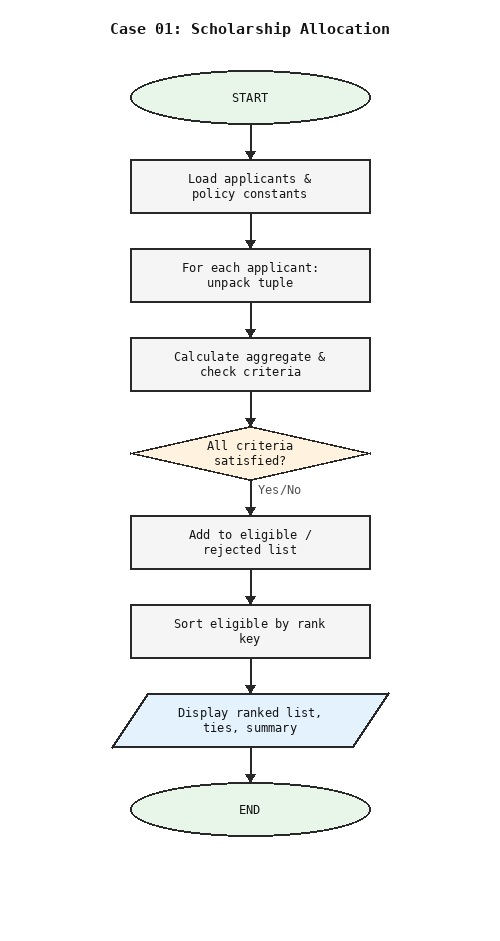
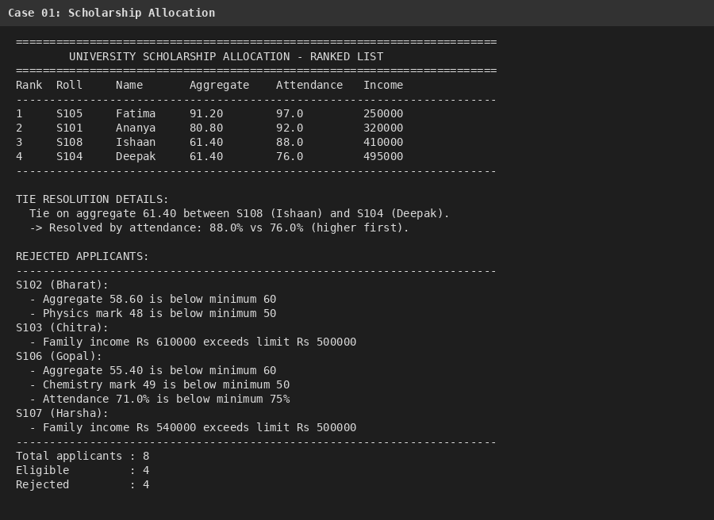

# Case Study 01 — University Scholarship Allocation

## Problem statement

Design a system that evaluates applicants using aggregate marks, subject-wise minimum scores, attendance, and income criteria, ranks eligible students, and resolves ties using predefined rules.

## Objectives

To store applicant data using tuples and lists, apply eligibility conditions using conditional statements, calculate aggregate marks using loops, rank eligible students, and handle tie-breaking rules clearly.

## Assumptions

Each applicant has 5 subject marks out of 100. Aggregate is the average of all subjects. Minimum aggregate is 60, minimum subject mark is 50, minimum attendance is 75%, and maximum family income is Rs 5,00,000. Tie-breaking order: higher aggregate, higher attendance, lower income, then roll number.

## Algorithm

```
1. Start
2. Store policy constants and applicant records (tuples/lists)
3. For each applicant:
   a. Unpack roll, name, marks, attendance, income
   b. Calculate aggregate using a loop
   c. Check aggregate, subject-wise minimum, attendance, income
   d. If all conditions pass, add to eligible list; else add to rejected list with reasons
4. Sort eligible list using tie-breaking key
5. Display ranked eligible applicants
6. Check and display tie resolution details
7. Display rejected applicants with reasons
8. Display summary counts
9. Stop
```

## Flowchart



## Pseudocode

```
BEGIN
  SET policy constants
  SET eligible = empty list
  SET rejected = empty list

  FOR each applicant IN APPLICANTS DO
    UNPACK applicant
    CALCULATE aggregate
    SET reasons = empty list

    IF aggregate < MIN_AGGREGATE THEN ADD reason ENDIF
    FOR each subject mark DO
      IF mark < MIN_SUBJECT THEN ADD reason ENDIF
    ENDFOR
    IF attendance < MIN_ATTENDANCE THEN ADD reason ENDIF
    IF income > MAX_INCOME THEN ADD reason ENDIF

    IF reasons is empty THEN
      ADD to eligible
    ELSE
      ADD to rejected
    ENDIF
  ENDFOR

  SORT eligible by (-aggregate, -attendance, income, roll)
  DISPLAY ranked table
  DISPLAY tie resolution log
  DISPLAY rejected list
  DISPLAY summary
END
```

## Python source code

```python
"""
Case Study 01: University Scholarship Allocation
Name: CHEERE MOHITH KUMAR | Roll No: 26000457

Syllabus topics used: variables, data types, operators, conditional statements,
loops, lists, tuples, tuple unpacking.
"""

# Policy limits
MIN_AGGREGATE = 60.0
MIN_SUBJECT = 50
MIN_ATTENDANCE = 75.0
MAX_INCOME = 500000

SUBJECTS = ["Maths", "Physics", "Chemistry", "English", "CS"]

# Each record: (roll_no, name, marks_list, attendance_percent, family_income)
APPLICANTS = [
    ("S101", "Ananya",  [82, 76, 90, 71, 85], 92.0, 320000),
    ("S102", "Bharat",  [55, 48, 62, 70, 58], 78.0, 480000),
    ("S103", "Chitra",  [74, 69, 71, 66, 80], 84.0, 610000),
    ("S104", "Deepak",  [61, 57, 64, 59, 66], 76.0, 495000),
    ("S105", "Fatima",  [91, 88, 94, 87, 96], 97.0, 250000),
    ("S106", "Gopal",   [58, 52, 49, 63, 55], 71.0, 300000),
    ("S107", "Harsha",  [77, 72, 68, 74, 70], 80.0, 540000),
    ("S108", "Ishaan",  [64, 58, 66, 60, 59], 88.0, 410000),
]


def check_applicant(applicant):
    """Check one applicant and return (is_eligible, aggregate, reasons)."""
    roll, name, marks, attendance, income = applicant

    total = 0
    for m in marks:
        total = total + m
    aggregate = total / len(marks)

    reasons = []

    if aggregate < MIN_AGGREGATE:
        reasons.append("Aggregate %.2f is below minimum %.0f" % (aggregate, MIN_AGGREGATE))

    i = 0
    while i < len(marks):
        if marks[i] < MIN_SUBJECT:
            reasons.append("%s mark %d is below minimum %d" % (SUBJECTS[i], marks[i], MIN_SUBJECT))
        i = i + 1

    if attendance < MIN_ATTENDANCE:
        reasons.append("Attendance %.1f%% is below minimum %.0f%%" % (attendance, MIN_ATTENDANCE))

    if income > MAX_INCOME:
        reasons.append("Family income Rs %d exceeds limit Rs %d" % (income, MAX_INCOME))

    eligible = (len(reasons) == 0)
    return eligible, aggregate, reasons


def sort_key(record):
    # record = (roll, name, aggregate, attendance, income)
    roll, name, agg, att, inc = record
    # higher aggregate, higher attendance, lower income, then roll number
    return (-agg, -att, inc, roll)


def main():
    eligible_list = []
    rejected_list = []

    for app in APPLICANTS:
        ok, agg, reasons = check_applicant(app)
        roll, name, marks, attendance, income = app
        if ok:
            eligible_list.append((roll, name, round(agg, 2), attendance, income))
        else:
            rejected_list.append((roll, name, reasons))

    eligible_list.sort(key=sort_key)

    print("=" * 72)
    print("        UNIVERSITY SCHOLARSHIP ALLOCATION - RANKED LIST")
    print("=" * 72)
    print("%-5s %-8s %-10s %-12s %-12s %-10s" % ("Rank", "Roll", "Name", "Aggregate", "Attendance", "Income"))
    print("-" * 72)

    rank = 1
    for rec in eligible_list:
        roll, name, agg, att, inc = rec
        print("%-5d %-8s %-10s %-12.2f %-12.1f %-10d" % (rank, roll, name, agg, att, inc))
        rank = rank + 1

    print("-" * 72)

    # tie resolution check
    print("\nTIE RESOLUTION DETAILS:")
    found_tie = False
    i = 0
    while i < len(eligible_list) - 1:
        a = eligible_list[i]
        b = eligible_list[i + 1]
        if a[2] == b[2]:
            found_tie = True
            print("  Tie on aggregate %.2f between %s (%s) and %s (%s)." % (a[2], a[0], a[1], b[0], b[1]))
            if a[3] != b[3]:
                print("  -> Resolved by attendance: %.1f%% vs %.1f%% (higher first)." % (a[3], b[3]))
            elif a[4] != b[4]:
                print("  -> Resolved by income: Rs %d vs Rs %d (lower first)." % (a[4], b[4]))
            else:
                print("  -> Resolved by roll number.")
        i = i + 1
    if not found_tie:
        print("  No aggregate ties found.")

    print("\nREJECTED APPLICANTS:")
    print("-" * 72)
    for item in rejected_list:
        roll, name, reasons = item
        print("%s (%s):" % (roll, name))
        for r in reasons:
            print("  - " + r)

    print("-" * 72)
    print("Total applicants : %d" % len(APPLICANTS))
    print("Eligible         : %d" % len(eligible_list))
    print("Rejected         : %d" % len(rejected_list))


if __name__ == "__main__":
    main()
```

## Test cases

9 checks covering: eligible applicant acceptance, aggregate calculation, aggregate rejection, subject-wise failure, income rejection, attendance rejection, ranking order, tie-breaking by attendance, and total eligible/rejected counts. All tests passed.

## Output screenshot



## Conclusion

The program evaluates all applicants against the given policy rules, ranks eligible students using a clear tie-breaking order, and reports rejection reasons. It uses tuples, lists, loops, conditionals, and tuple unpacking as required.
