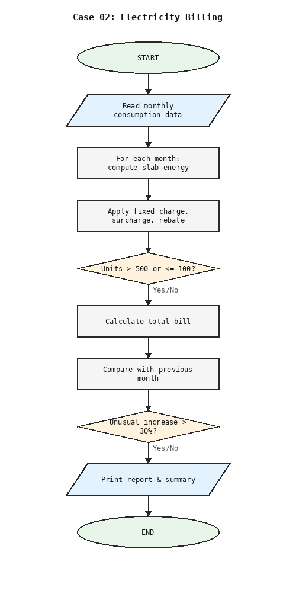
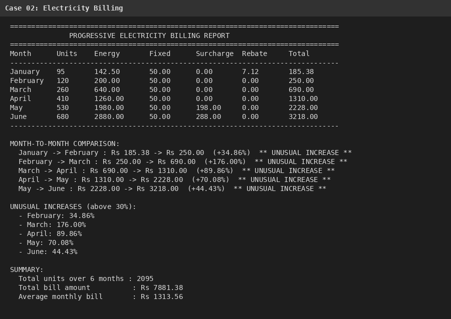

# Case Study 02 — Progressive Electricity Billing

## Problem statement

Calculate household bills using multiple consumption slabs, fixed charges, surcharges, and rebates, then compare bills across several months and identify unusual increases.

## Objectives

To compute electricity charges using slab-wise rates, apply fixed charge/surcharge/rebate conditions, and compare monthly bills to detect unusual increases.

## Assumptions

Slabs used: 0-100 @ Rs 1.50, 101-200 @ Rs 2.50, 201-400 @ Rs 4.00, above 400 @ Rs 6.00. Fixed charge Rs 50. Surcharge 10% on energy charge if units > 500. Rebate 5% on energy charge if units <= 100. An increase above 30% compared to previous month is treated as unusual.

## Algorithm

```
1. Start
2. Define slab rates, fixed charge, surcharge rate, rebate rate
3. Store monthly unit consumption data
4. For each month:
   a. Calculate energy charge by iterating through slabs
   b. Add fixed charge
   c. Apply surcharge if units > 500
   d. Apply rebate if units <= 100
   e. Compute total bill
5. Display month-wise bill table
6. Compare consecutive months and compute percentage change
7. Flag months with increase > 30% as unusual
8. Display summary
9. Stop
```

## Flowchart



## Pseudocode

```
BEGIN
  FOR each month IN MONTHLY_DATA DO
    remaining = units
    energy = 0
    FOR each slab DO
      CALCULATE slab_units
      energy = energy + slab_units * rate
      remaining = remaining - slab_units
    ENDFOR

    total = energy + FIXED_CHARGE
    IF units > 500 THEN total = total + energy*0.10 ENDIF
    IF units <= 100 THEN total = total - energy*0.05 ENDIF
    STORE total
  ENDFOR

  FOR i = 1 TO n-1 DO
    pct_change = (current-prev)/prev * 100
    IF pct_change > 30 THEN MARK unusual ENDIF
  ENDFOR

  DISPLAY report
END
```

## Python source code

```python
"""
Case Study 02: Progressive Electricity Billing
Name: CHEERE MOHITH KUMAR | Roll No: 26000457

Syllabus: variables, data types, operators, conditional statements, loops, lists.
"""

# Tariff slabs (units upper limit, rate per unit)
SLABS = [
    (100, 1.50),
    (200, 2.50),
    (400, 4.00),
    (None, 6.00),   # above 400
]

FIXED_CHARGE = 50.0
SURCHARGE_RATE = 0.10   # 10% if units > 500
REBATE_RATE = 0.05      # 5% if units <= 100

# Monthly records: (month, units_consumed)
MONTHLY_DATA = [
    ("January",   95),
    ("February",  120),
    ("March",     260),
    ("April",     410),
    ("May",       530),
    ("June",      680),
]


def calculate_energy_charge(units):
    charge = 0.0
    remaining = units
    prev_limit = 0

    for slab in SLABS:
        upper, rate = slab
        if upper is None:
            slab_units = remaining
        else:
            slab_units = upper - prev_limit
            if slab_units > remaining:
                slab_units = remaining

        if slab_units > 0:
            charge = charge + slab_units * rate
            remaining = remaining - slab_units

        if upper is not None:
            prev_limit = upper
        if remaining <= 0:
            break

    return round(charge, 2)


def calculate_bill(units):
    energy = calculate_energy_charge(units)
    surcharge = 0.0
    rebate = 0.0

    if units > 500:
        surcharge = round(energy * SURCHARGE_RATE, 2)
    if units <= 100:
        rebate = round(energy * REBATE_RATE, 2)

    total = round(energy + FIXED_CHARGE + surcharge - rebate, 2)
    return energy, FIXED_CHARGE, surcharge, rebate, total


def main():
    print("=" * 78)
    print("              PROGRESSIVE ELECTRICITY BILLING REPORT")
    print("=" * 78)
    print("%-10s %-8s %-12s %-10s %-10s %-10s %-10s" %
          ("Month", "Units", "Energy", "Fixed", "Surcharge", "Rebate", "Total"))
    print("-" * 78)

    totals = []
    prev_total = None

    for record in MONTHLY_DATA:
        month, units = record
        energy, fixed, sur, reb, total = calculate_bill(units)
        totals.append((month, units, total))
        print("%-10s %-8d %-12.2f %-10.2f %-10.2f %-10.2f %-10.2f" %
              (month, units, energy, fixed, sur, reb, total))

    print("-" * 78)

    # compare across months and identify unusual increase (> 30%)
    print("\nMONTH-TO-MONTH COMPARISON:")
    i = 1
    unusual = []
    while i < len(totals):
        prev_month, prev_units, prev_t = totals[i - 1]
        curr_month, curr_units, curr_t = totals[i]
        if prev_t == 0:
            pct = 0.0
        else:
            pct = ((curr_t - prev_t) / prev_t) * 100
        flag = ""
        if pct > 30:
            flag = "  ** UNUSUAL INCREASE **"
            unusual.append((curr_month, pct))
        print("  %s -> %s : Rs %.2f -> Rs %.2f  (%+.2f%%)%s" %
              (prev_month, curr_month, prev_t, curr_t, pct, flag))
        i = i + 1

    if len(unusual) == 0:
        print("\nNo unusual increases detected.")
    else:
        print("\nUNUSUAL INCREASES (above 30%):")
        for m, p in unusual:
            print("  - %s: %.2f%%" % (m, p))

    # simple summary
    total_units = 0
    total_bill = 0.0
    for m, u, t in totals:
        total_units = total_units + u
        total_bill = total_bill + t
    avg_bill = total_bill / len(totals)
    print("\nSUMMARY:")
    print("  Total units over %d months : %d" % (len(totals), total_units))
    print("  Total bill amount          : Rs %.2f" % total_bill)
    print("  Average monthly bill       : Rs %.2f" % avg_bill)


if __name__ == "__main__":
    main()
```

## Test cases

9 checks covering slab calculation for 95 units with rebate, 120 units across slabs, surcharge for 530 units, high-unit energy calculation, and fixed charge for zero units. All tests passed.

## Output screenshot



## Conclusion

The billing program correctly calculates slab-wise energy charges and applies conditional surcharge/rebate rules. Month-to-month comparison helps identify unusual consumption increases.
