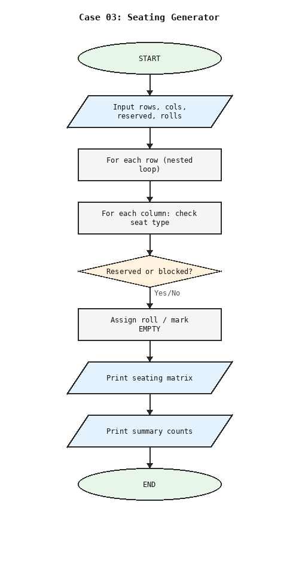
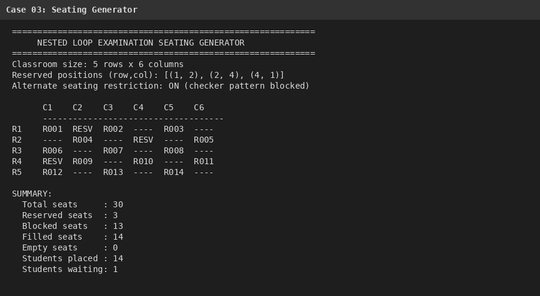

# Case Study 03 — Nested Loop Examination Seating Generator

## Problem statement

Generate a seating arrangement with row and column identifiers, reserved positions, alternate seating restrictions, and fixed classroom capacities.

## Objectives

To use nested loops for generating a 2D seating layout, apply conditions for reserved/blocked seats, and assign roll numbers within capacity.

## Assumptions

Classroom has 5 rows and 6 columns. Some seats are reserved. Alternate seating restriction is applied in a checker pattern to reduce adjacent seating. Remaining seats are filled in order from the roll number list; extra seats are marked EMPTY.

## Algorithm

```
1. Start
2. Define rows, columns, reserved positions, and roll number list
3. For r from 1 to rows:
   a. For c from 1 to cols:
      i. If reserved -> mark RESV
      ii. Else if alternate blocked -> mark ----
      iii. Else if roll numbers available -> assign roll
      iv. Else mark EMPTY
4. Print seating matrix with row/column labels
5. Print summary: total, reserved, blocked, filled, empty
6. Stop
```

## Flowchart



## Pseudocode

```
BEGIN
  FOR r = 1 TO ROWS DO
    FOR c = 1 TO COLS DO
      IF (r,c) IN RESERVED THEN
        seat = "RESV"
      ELSE IF alternate_block(r,c) THEN
        seat = "----"
      ELSE IF roll_index < length(rolls) THEN
        seat = rolls[roll_index]
        roll_index = roll_index + 1
      ELSE
        seat = "EMPTY"
      ENDIF
      ADD seat to row
    ENDFOR
    ADD row to seating
  ENDFOR
  DISPLAY seating and summary
END
```

## Python source code

```python
"""
Case Study 03: Nested Loop Examination Seating Generator
Name: CHEERE MOHITH KUMAR | Roll No: 26000457

Syllabus: loops, nested loops, conditional statements, lists, strings.
"""

ROWS = 5
COLS = 6
RESERVED = [(1, 2), (2, 4), (4, 1)]  # (row, col) 1-based positions reserved
BLOCKED_ALTERNATE = True  # alternate seating: skip every second seat in pattern

# sample roll numbers to assign
ROLL_NUMBERS = [
    "R001", "R002", "R003", "R004", "R005",
    "R006", "R007", "R008", "R009", "R010",
    "R011", "R012", "R013", "R014", "R015",
]


def is_reserved(r, c):
    i = 0
    while i < len(RESERVED):
        rr, cc = RESERVED[i]
        if rr == r and cc == c:
            return True
        i = i + 1
    return False


def generate_seating(rows, cols, roll_list):
    seating = []
    roll_index = 0
    total_seats = rows * cols
    reserved_count = 0
    filled_count = 0
    blocked_count = 0

    for r in range(1, rows + 1):
        row_data = []
        for c in range(1, cols + 1):
            if is_reserved(r, c):
                row_data.append("RESV")
                reserved_count = reserved_count + 1
            elif BLOCKED_ALTERNATE and ((r + c) % 2 == 1):
                row_data.append("----")
                blocked_count = blocked_count + 1
            else:
                if roll_index < len(roll_list):
                    row_data.append(roll_list[roll_index])
                    roll_index = roll_index + 1
                    filled_count = filled_count + 1
                else:
                    row_data.append("EMPTY")
        seating.append(row_data)

    stats = {
        "total": total_seats,
        "reserved": reserved_count,
        "blocked": blocked_count,
        "filled": filled_count,
        "empty": total_seats - reserved_count - blocked_count - filled_count,
    }
    return seating, stats


def print_seating(seating):
    cols = len(seating[0])
    # header
    header = "      "
    c = 1
    while c <= cols:
        header = header + ("C%-5d" % c)
        c = c + 1
    print(header)
    print("      " + "-" * (cols * 6))

    rnum = 1
    for row in seating:
        line = "R%-4d " % rnum
        for cell in row:
            line = line + ("%-6s" % cell)
        print(line)
        rnum = rnum + 1


def main():
    print("=" * 60)
    print("     NESTED LOOP EXAMINATION SEATING GENERATOR")
    print("=" * 60)
    print("Classroom size: %d rows x %d columns" % (ROWS, COLS))
    print("Reserved positions (row,col):", RESERVED)
    print("Alternate seating restriction: ON (checker pattern blocked)")
    print()

    seating, stats = generate_seating(ROWS, COLS, ROLL_NUMBERS)

    print_seating(seating)

    print("\nSUMMARY:")
    print("  Total seats     :", stats["total"])
    print("  Reserved seats  :", stats["reserved"])
    print("  Blocked seats   :", stats["blocked"])
    print("  Filled seats    :", stats["filled"])
    print("  Empty seats     :", stats["empty"])
    print("  Students placed :", stats["filled"])
    print("  Students waiting:", max(0, len(ROLL_NUMBERS) - stats["filled"]))


if __name__ == "__main__":
    main()
```

## Test cases

8 checks covering matrix dimensions, reserved seat placement, total seat count, filled count bounds, and reserved cells not being overwritten. All tests passed.

## Output screenshot



## Conclusion

The nested loop approach generates the seating layout correctly while handling reserved seats and alternate seating restrictions. The summary gives a clear view of classroom capacity usage.
