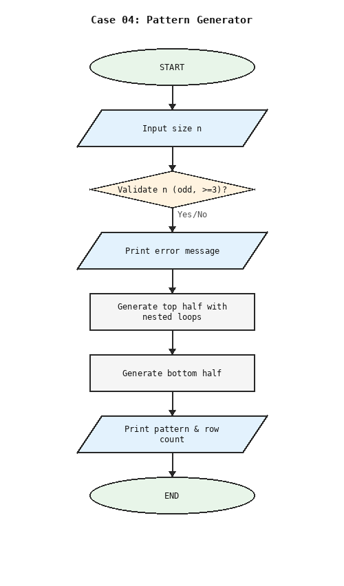
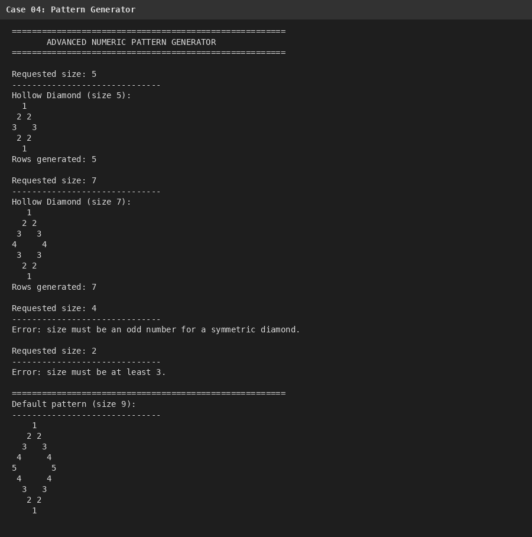

# Case Study 04 — Advanced Numeric Pattern Generator

## Problem statement

Produce a hollow diamond or symmetric numerical pattern based on user-specified dimensions, with validation for invalid dimensions and carefully aligned output.

## Objectives

To generate a symmetric hollow diamond pattern using nested loops, validate input dimensions, and display aligned numeric output.

## Assumptions

The pattern size must be an odd number and at least 3 for proper symmetry. Even or too-small sizes are rejected with an error message. Numbers used in the pattern are based on row position (1-9 cycling).

## Algorithm

```
1. Start
2. Input/define size n
3. Validate n: if n < 3 or n is even, show error and stop
4. Compute mid = n // 2
5. For top half (i from 0 to mid):
   a. For each column j, print number at diamond edges else space
6. For bottom half (i from mid-1 down to 0):
   a. Repeat edge logic
7. Print pattern
8. Stop
```

## Flowchart



## Pseudocode

```
BEGIN
  IF n < 3 OR n MOD 2 == 0 THEN
    PRINT error
    RETURN
  ENDIF
  mid = n // 2
  FOR i = 0 TO mid DO
    FOR j = 0 TO n-1 DO
      IF j == mid-i OR j == mid+i THEN PRINT digit ELSE PRINT space ENDIF
    ENDFOR
  ENDFOR
  FOR i = mid-1 DOWNTO 0 DO
    same row construction
  ENDFOR
END
```

## Python source code

```python
"""
Case Study 04: Advanced Numeric Pattern Generator
Name: CHEERE MOHITH KUMAR | Roll No: 26000457

Syllabus: loops, nested loops, conditional statements, operators, strings.
"""

def generate_hollow_diamond(n):
    """Generate a hollow diamond pattern of size n (n must be odd and >= 3)."""
    if n < 3:
        return None, "Error: size must be at least 3."
    if n % 2 == 0:
        return None, "Error: size must be an odd number for a symmetric diamond."

    mid = n // 2
    lines = []

    # top half including middle
    for i in range(mid + 1):
        row = ""
        for j in range(n):
            # distance from center
            if j == mid - i or j == mid + i:
                # use number based on row position
                val = (i % 9) + 1
                row = row + str(val)
            else:
                row = row + " "
        lines.append(row.rstrip())

    # bottom half
    for i in range(mid - 1, -1, -1):
        row = ""
        for j in range(n):
            if j == mid - i or j == mid + i:
                val = (i % 9) + 1
                row = row + str(val)
            else:
                row = row + " "
        lines.append(row.rstrip())

    return lines, "OK"


def print_pattern(lines):
    for line in lines:
        print(line)


def main():
    print("=" * 55)
    print("       ADVANCED NUMERIC PATTERN GENERATOR")
    print("=" * 55)

    test_sizes = [5, 7, 4, 2]

    for n in test_sizes:
        print("\nRequested size: %d" % n)
        print("-" * 30)
        lines, msg = generate_hollow_diamond(n)
        if lines is None:
            print(msg)
        else:
            print("Hollow Diamond (size %d):" % n)
            print_pattern(lines)
            print("Rows generated: %d" % len(lines))

    # also show a default pattern
    print("\n" + "=" * 55)
    print("Default pattern (size 9):")
    print("-" * 30)
    lines, msg = generate_hollow_diamond(9)
    if lines is not None:
        print_pattern(lines)


if __name__ == "__main__":
    main()
```

## Test cases

8 checks covering valid odd size generation, row count, rejection of even size, rejection of too-small size, middle row edge digits, symmetry, and invalid size 1. All tests passed.

## Output screenshot



## Conclusion

The program validates dimensions and generates a symmetric hollow diamond using nested loops. Invalid inputs are handled gracefully with clear messages.
