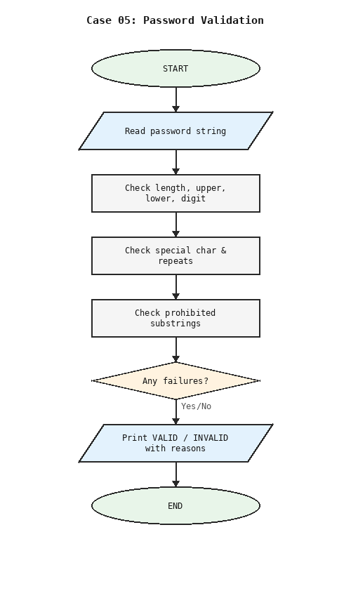
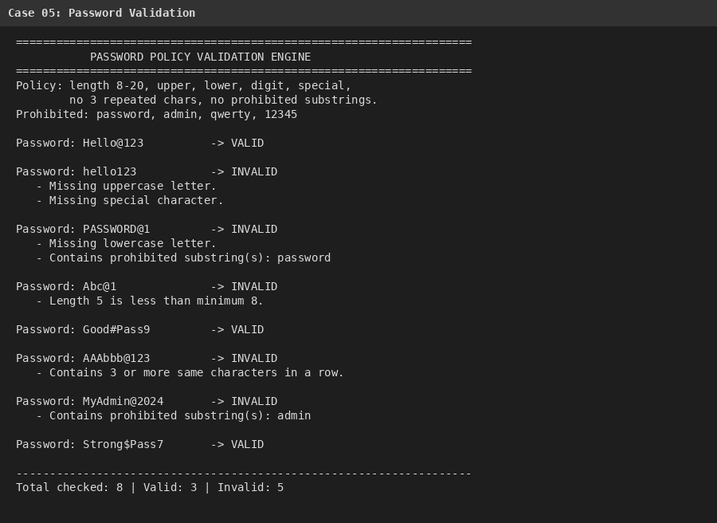

# Case Study 05 — Password Policy Validation Engine

## Problem statement

Evaluate sample password strings against minimum length, character-category, repetition, and prohibited-substring rules; explain each failed condition.

## Objectives

To validate passwords using string traversal, conditional checks, and loops; and to report every failed rule clearly.

## Assumptions

Password must be 8-20 characters, contain at least one uppercase, one lowercase, one digit, and one special character. It must not contain 3 same consecutive characters and must not include prohibited substrings like password, admin, qwerty, 12345 (case-insensitive check).

## Algorithm

```
1. Start
2. Define policy rules and prohibited substrings
3. For each password:
   a. Check length range
   b. Check uppercase, lowercase, digit, special character presence
   c. Check for 3 consecutive repeated characters
   d. Check for prohibited substrings (case-insensitive)
   e. If no failures -> VALID else INVALID with reasons
4. Display results and summary
5. Stop
```

## Flowchart



## Pseudocode

```
BEGIN
  FUNCTION validate(pwd)
    failures = []
    IF length < MIN OR length > MAX THEN ADD failure ENDIF
    IF no uppercase THEN ADD failure ENDIF
    IF no lowercase THEN ADD failure ENDIF
    IF no digit THEN ADD failure ENDIF
    IF no special THEN ADD failure ENDIF
    IF has 3 repeated consecutive chars THEN ADD failure ENDIF
    IF contains prohibited substring THEN ADD failure ENDIF
    RETURN (failures empty, failures)
  END FUNCTION
END
```

## Python source code

```python
"""
Case Study 05: Password Policy Validation Engine
Name: CHEERE MOHITH KUMAR | Roll No: 26000457

Syllabus: strings, loops, conditional statements, operators, lists.
"""

MIN_LENGTH = 8
MAX_LENGTH = 20
SPECIAL_CHARS = "!@#$%^&*()-_=+[]{}|;:,.<>?/"
PROHIBITED = ["password", "admin", "qwerty", "12345"]


def has_upper(s):
    for ch in s:
        if ch >= 'A' and ch <= 'Z':
            return True
    return False


def has_lower(s):
    for ch in s:
        if ch >= 'a' and ch <= 'z':
            return True
    return False


def has_digit(s):
    for ch in s:
        if ch >= '0' and ch <= '9':
            return True
    return False


def has_special(s):
    for ch in s:
        if ch in SPECIAL_CHARS:
            return True
    return False


def has_repeated_chars(s, limit=3):
    # returns True if any character repeats 'limit' or more times consecutively
    if len(s) == 0:
        return False
    count = 1
    i = 1
    while i < len(s):
        if s[i] == s[i - 1]:
            count = count + 1
            if count >= limit:
                return True
        else:
            count = 1
        i = i + 1
    return False


def contains_prohibited(s):
    low = s.lower()
    found = []
    for p in PROHIBITED:
        if p in low:
            found.append(p)
    return found


def validate_password(pwd):
    failures = []

    if len(pwd) < MIN_LENGTH:
        failures.append("Length %d is less than minimum %d." % (len(pwd), MIN_LENGTH))
    if len(pwd) > MAX_LENGTH:
        failures.append("Length %d exceeds maximum %d." % (len(pwd), MAX_LENGTH))

    if not has_upper(pwd):
        failures.append("Missing uppercase letter.")
    if not has_lower(pwd):
        failures.append("Missing lowercase letter.")
    if not has_digit(pwd):
        failures.append("Missing digit.")
    if not has_special(pwd):
        failures.append("Missing special character.")

    if has_repeated_chars(pwd, 3):
        failures.append("Contains 3 or more same characters in a row.")

    bad_words = contains_prohibited(pwd)
    if len(bad_words) > 0:
        failures.append("Contains prohibited substring(s): " + ", ".join(bad_words))

    is_valid = (len(failures) == 0)
    return is_valid, failures


def main():
    print("=" * 68)
    print("           PASSWORD POLICY VALIDATION ENGINE")
    print("=" * 68)
    print("Policy: length %d-%d, upper, lower, digit, special," % (MIN_LENGTH, MAX_LENGTH))
    print("        no 3 repeated chars, no prohibited substrings.")
    print("Prohibited:", ", ".join(PROHIBITED))
    print()

    test_passwords = [
        "Hello@123",
        "hello123",
        "PASSWORD@1",
        "Abc@1",
        "Good#Pass9",
        "AAAbbb@123",
        "MyAdmin@2024",
        "Strong$Pass7",
    ]

    for pwd in test_passwords:
        valid, failures = validate_password(pwd)
        status = "VALID" if valid else "INVALID"
        print("Password: %-18s -> %s" % (pwd, status))
        if not valid:
            for f in failures:
                print("   - " + f)
        print()

    # summary
    valid_count = 0
    for pwd in test_passwords:
        v, _ = validate_password(pwd)
        if v:
            valid_count = valid_count + 1
    print("-" * 68)
    print("Total checked: %d | Valid: %d | Invalid: %d" %
          (len(test_passwords), valid_count, len(test_passwords) - valid_count))


if __name__ == "__main__":
    main()
```

## Test cases

8 checks covering a valid password, missing categories, short password, prohibited substring, repeated characters, missing digit, another valid case, and 'password' substring rejection. All tests passed.

## Output screenshot



## Conclusion

The validation engine checks multiple password policy rules and reports each failed condition. String loops and conditionals are sufficient to implement the policy.
