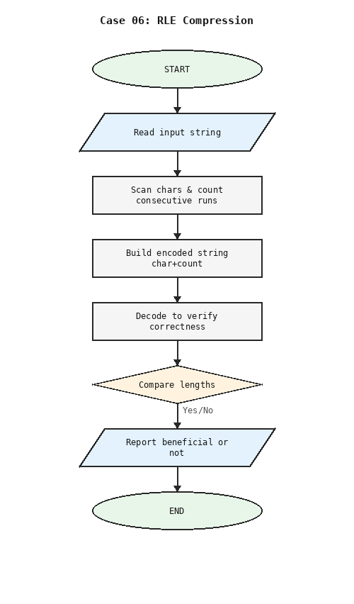
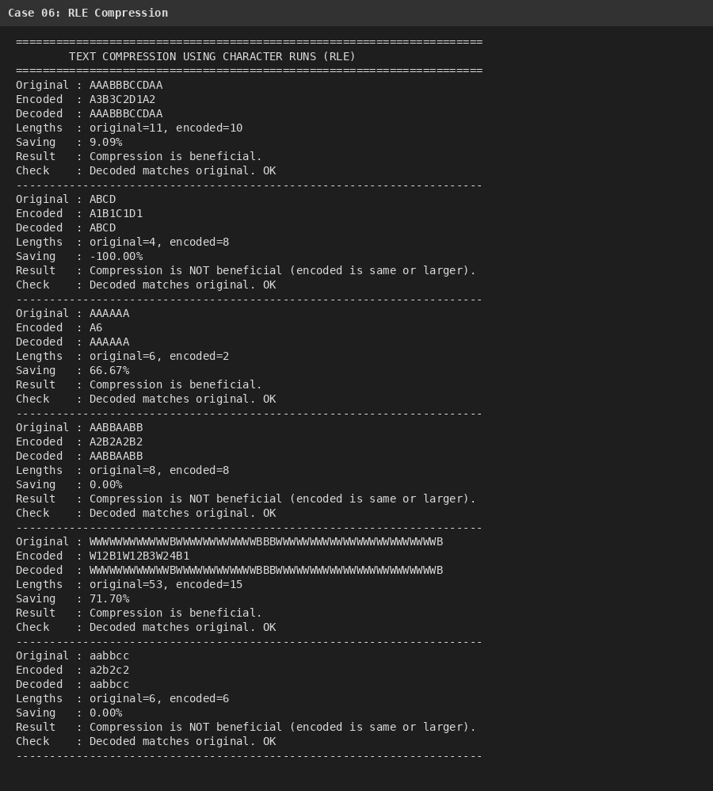

# Case Study 06 — Text Compression Using Character Runs

## Problem statement

Encode a string by grouping consecutive repeated characters and compare original and encoded lengths, including cases where encoding is not beneficial.

## Objectives

To implement run-length encoding using string traversal and loops, decode to verify correctness, and compare compression benefit.

## Assumptions

Encoding format is character followed by run count (e.g., AAAB -> A3B1). Only consecutive repeated characters are grouped. The program also checks cases where encoding increases length.

## Algorithm

```
1. Start
2. Read input string
3. If empty, return empty
4. Traverse string and count consecutive same characters
5. Append character + count to encoded string
6. Decode encoded string to verify
7. Compare original and encoded lengths
8. Report whether compression is beneficial
9. Stop
```

## Flowchart



## Pseudocode

```
BEGIN
  FUNCTION rle_encode(text)
    IF text is empty RETURN ""
    count = 1
    FOR i = 1 TO len(text)-1 DO
      IF text[i] == text[i-1] THEN count++
      ELSE
        encoded += text[i-1] + str(count)
        count = 1
      ENDIF
    ENDFOR
    encoded += last_char + str(count)
    RETURN encoded
  END FUNCTION

  COMPARE lengths and report benefit
END
```

## Python source code

```python
"""
Case Study 06: Text Compression Using Character Runs (RLE)
Name: CHEERE MOHITH KUMAR | Roll No: 26000457

Syllabus: strings, loops, conditional statements, operators.
"""

def rle_encode(text):
    """Encode string using run-length encoding. Returns encoded string."""
    if text == "":
        return ""

    encoded = ""
    count = 1
    i = 1
    while i < len(text):
        if text[i] == text[i - 1]:
            count = count + 1
        else:
            encoded = encoded + text[i - 1] + str(count)
            count = 1
        i = i + 1
    # last run
    encoded = encoded + text[len(text) - 1] + str(count)
    return encoded


def rle_decode(encoded):
    """Decode a simple RLE string like A3B2C1."""
    decoded = ""
    i = 0
    while i < len(encoded):
        ch = encoded[i]
        i = i + 1
        num_str = ""
        while i < len(encoded) and encoded[i].isdigit():
            num_str = num_str + encoded[i]
            i = i + 1
        if num_str == "":
            count = 1
        else:
            count = int(num_str)
        j = 0
        while j < count:
            decoded = decoded + ch
            j = j + 1
    return decoded


def compression_info(original, encoded):
    orig_len = len(original)
    enc_len = len(encoded)
    if orig_len == 0:
        saving = 0.0
    else:
        saving = ((orig_len - enc_len) / orig_len) * 100
    beneficial = enc_len < orig_len
    return orig_len, enc_len, saving, beneficial


def main():
    print("=" * 70)
    print("        TEXT COMPRESSION USING CHARACTER RUNS (RLE)")
    print("=" * 70)

    test_strings = [
        "AAABBBCCDAA",
        "ABCD",
        "AAAAAA",
        "AABBAABB",
        "WWWWWWWWWWWWBWWWWWWWWWWWWBBBWWWWWWWWWWWWWWWWWWWWWWWWB",
        "aabbcc",
    ]

    for s in test_strings:
        encoded = rle_encode(s)
        decoded = rle_decode(encoded)
        orig_len, enc_len, saving, beneficial = compression_info(s, encoded)

        print("Original : %s" % s)
        print("Encoded  : %s" % encoded)
        print("Decoded  : %s" % decoded)
        print("Lengths  : original=%d, encoded=%d" % (orig_len, enc_len))
        print("Saving   : %.2f%%" % saving)
        if beneficial:
            print("Result   : Compression is beneficial.")
        else:
            print("Result   : Compression is NOT beneficial (encoded is same or larger).")
        # verify correctness
        if decoded == s:
            print("Check    : Decoded matches original. OK")
        else:
            print("Check    : Mismatch! ERROR")
        print("-" * 70)


if __name__ == "__main__":
    main()
```

## Test cases

8 checks covering basic encoding, decode round-trip, non-beneficial case (ABCD), beneficial case (AAAAAA), empty string, single char, long round-trip, and equal-length case. All tests passed.

## Output screenshot



## Conclusion

The RLE program correctly compresses repeated character runs and also identifies when compression is not beneficial. The decode check confirms correctness.
