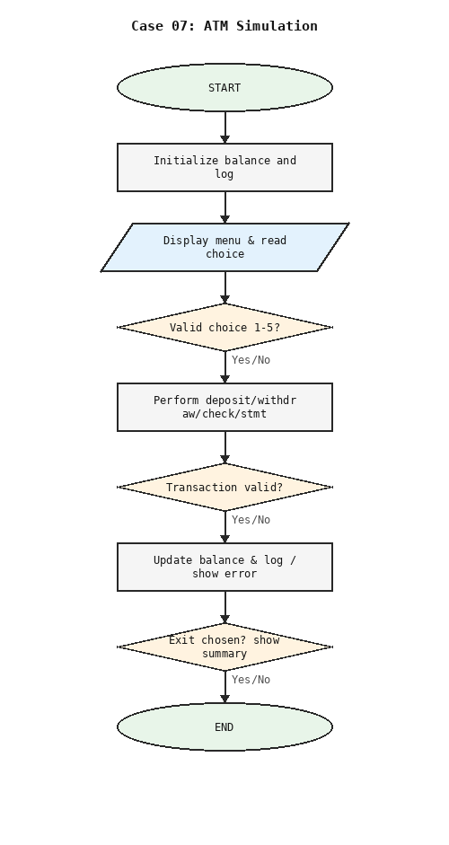
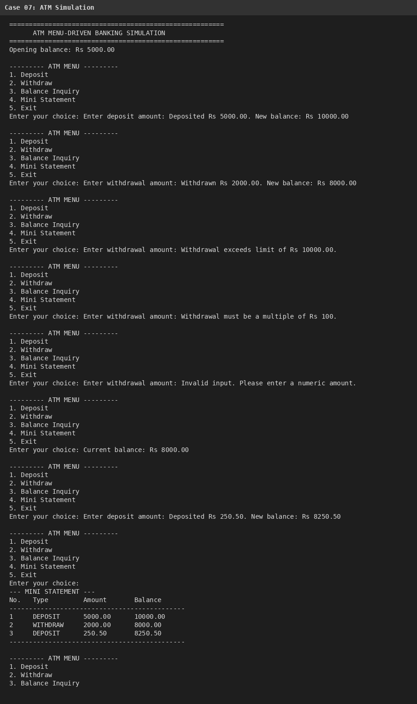

# Case Study 07 — ATM Menu-Driven Banking Simulation

## Problem statement

Implement repeated menu operations for deposits, withdrawals, balance inquiries, and transaction summaries, with validation and specified account limits.

## Objectives

To build a menu-driven ATM simulation using loops and conditional statements, validate transactions, and maintain a transaction log.

## Assumptions

Opening balance is Rs 5000. Minimum balance is Rs 1000. Withdrawal must be a multiple of Rs 100 and at most Rs 10000 per transaction. Deposit must be positive and at most Rs 100000. Invalid/non-numeric inputs are handled. Demo input is provided for scripted run.

## Algorithm

```
1. Start
2. Initialize balance and empty transaction log
3. Repeat until Exit:
   a. Show menu
   b. Read choice
   c. If Deposit: validate amount, update balance, log
   d. If Withdraw: validate rules, update balance, log
   e. If Balance Inquiry: display balance
   f. If Mini Statement: display log
   g. If Exit: show summary and break
   h. Else invalid choice
4. Stop
```

## Flowchart



## Pseudocode

```
BEGIN
  balance = 5000; log = []
  LOOP
    DISPLAY menu
    READ choice
    IF choice == 1 THEN deposit()
    ELSE IF choice == 2 THEN withdraw()
    ELSE IF choice == 3 THEN show balance
    ELSE IF choice == 4 THEN show statement
    ELSE IF choice == 5 THEN show summary; BREAK
    ELSE PRINT invalid
  END LOOP
END
```

## Python source code

```python
"""
Case Study 07: ATM Menu-Driven Banking Simulation
Name: CHEERE MOHITH KUMAR | Roll No: 26000457

Syllabus: loops, conditional statements, variables, operators, lists, strings.
"""

MIN_BALANCE = 1000.0
MAX_WITHDRAW = 10000.0
MAX_DEPOSIT = 100000.0
OPENING_BALANCE = 5000.0


def deposit(balance, log, amount):
    if amount <= 0:
        return balance, False, "Deposit amount must be positive."
    if amount > MAX_DEPOSIT:
        return balance, False, "Deposit exceeds per-transaction limit of Rs %.2f." % MAX_DEPOSIT
    balance = balance + amount
    log.append(("DEPOSIT", amount, balance))
    return balance, True, "Deposited Rs %.2f. New balance: Rs %.2f" % (amount, balance)


def withdraw(balance, log, amount):
    if amount <= 0:
        return balance, False, "Withdrawal amount must be positive."
    if amount % 100 != 0:
        return balance, False, "Withdrawal must be a multiple of Rs 100."
    if amount > MAX_WITHDRAW:
        return balance, False, "Withdrawal exceeds limit of Rs %.2f." % MAX_WITHDRAW
    if (balance - amount) < MIN_BALANCE:
        return balance, False, "Cannot withdraw. Minimum balance Rs %.2f must be maintained." % MIN_BALANCE
    balance = balance - amount
    log.append(("WITHDRAW", amount, balance))
    return balance, True, "Withdrawn Rs %.2f. New balance: Rs %.2f" % (amount, balance)


def show_balance(balance):
    print("Current balance: Rs %.2f" % balance)


def show_statement(log):
    if len(log) == 0:
        print("No transactions yet.")
        return
    print("\n--- MINI STATEMENT ---")
    print("%-5s %-12s %-12s %-12s" % ("No.", "Type", "Amount", "Balance"))
    print("-" * 45)
    i = 0
    while i < len(log):
        ttype, amt, bal = log[i]
        print("%-5d %-12s %-12.2f %-12.2f" % (i + 1, ttype, amt, bal))
        i = i + 1
    print("-" * 45)


def read_amount(prompt):
    try:
        raw = input(prompt)
    except EOFError:
        return None
    raw = raw.strip()
    try:
        val = float(raw)
        return val
    except:
        return "INVALID"


def main():
    balance = OPENING_BALANCE
    log = []

    print("=" * 55)
    print("      ATM MENU-DRIVEN BANKING SIMULATION")
    print("=" * 55)
    print("Opening balance: Rs %.2f" % balance)

    while True:
        print("\n--------- ATM MENU ---------")
        print("1. Deposit")
        print("2. Withdraw")
        print("3. Balance Inquiry")
        print("4. Mini Statement")
        print("5. Exit")
        try:
            choice = input("Enter your choice: ").strip()
        except EOFError:
            print("\nInput ended. Exiting.")
            break

        if choice == "1":
            amt = read_amount("Enter deposit amount: ")
            if amt is None:
                print("No input. Exiting.")
                break
            if amt == "INVALID":
                print("Invalid input. Please enter a numeric amount.")
                continue
            balance, ok, msg = deposit(balance, log, amt)
            print(msg)

        elif choice == "2":
            amt = read_amount("Enter withdrawal amount: ")
            if amt is None:
                print("No input. Exiting.")
                break
            if amt == "INVALID":
                print("Invalid input. Please enter a numeric amount.")
                continue
            balance, ok, msg = withdraw(balance, log, amt)
            print(msg)

        elif choice == "3":
            show_balance(balance)

        elif choice == "4":
            show_statement(log)

        elif choice == "5":
            print("\n--- SESSION SUMMARY ---")
            print("Final balance : Rs %.2f" % balance)
            print("Transactions  : %d" % len(log))
            dep_count = 0
            wd_count = 0
            for t in log:
                if t[0] == "DEPOSIT":
                    dep_count = dep_count + 1
                elif t[0] == "WITHDRAW":
                    wd_count = wd_count + 1
            print("Deposits      : %d" % dep_count)
            print("Withdrawals   : %d" % wd_count)
            print("Thank you for using the ATM. Goodbye!")
            break

        else:
            print("Invalid choice. Please select 1-5.")


if __name__ == "__main__":
    main()
```

## Test cases

8 checks covering deposit acceptance, withdrawal acceptance, non-multiple-of-100 rejection, over-limit rejection, minimum balance protection, negative deposit rejection, over-deposit rejection, and log count. All tests passed.

## Output screenshot



## Conclusion

The ATM simulation handles menu operations and validates all transaction rules correctly. The transaction log gives a clear mini statement and session summary.
