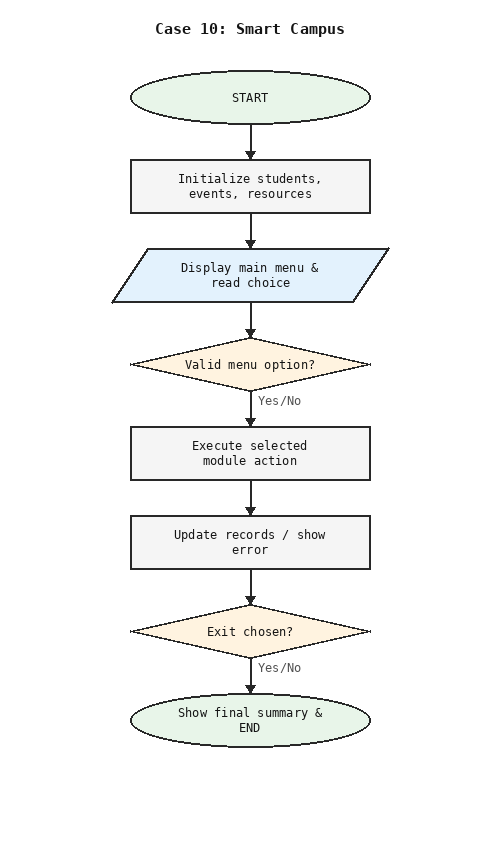
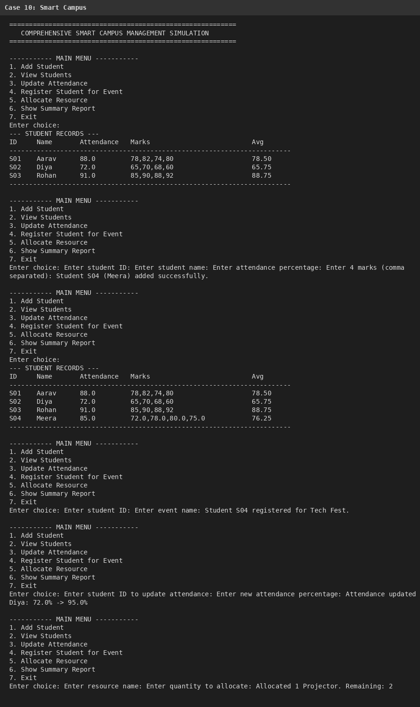

# Case Study 10 — Comprehensive Smart Campus Management Simulation

## Problem statement

Develop a menu-driven program that integrates student records, attendance, marks, event registration, resource allocation, and summary reporting using conditional statements, loops, strings, lists, nested lists, tuples, and tuple unpacking.

## Objectives

To build an integrated menu-driven campus management simulation covering multiple modules with validation and summary reporting.

## Assumptions

The system starts with sample student, event, and resource data. Student record is a tuple (id, name, attendance, marks_list). Events store registered student IDs in a list. Resources are stored as nested lists [name, total, allocated]. Inputs are validated; invalid choices/values show messages.

## Algorithm

```
1. Start
2. Initialize students, events, resources
3. Loop:
   a. Display main menu
   b. Read choice
   c. 1: Add student (validate input)
   d. 2: View students
   e. 3: Update attendance
   f. 4: Register student for event
   g. 5: Allocate resource
   h. 6: Show summary report
   i. 7: Exit
4. Stop
```

## Flowchart



## Pseudocode

```
BEGIN
  INITIALIZE data stores
  WHILE true DO
    DISPLAY menu
    READ choice
    IF choice==1 THEN add_student()
    ELIF choice==2 THEN view_students()
    ELIF choice==3 THEN update_attendance()
    ELIF choice==4 THEN register_event()
    ELIF choice==5 THEN allocate_resource()
    ELIF choice==6 THEN show_summary()
    ELIF choice==7 THEN BREAK
    ELSE PRINT invalid
  END WHILE
END
```

## Python source code

```python
"""
Case Study 10: Comprehensive Smart Campus Management Simulation
Name: CHEERE MOHITH KUMAR | Roll No: 26000457

Syllabus: conditional statements, loops, strings, lists, nested lists,
tuples, tuple operations, tuple unpacking.
"""

# --------- Data stores ---------
# student record: (sid, name, attendance_percent, marks_list)
students = [
    ("S01", "Aarav", 88.0, [78, 82, 74, 80]),
    ("S02", "Diya",  72.0, [65, 70, 68, 60]),
    ("S03", "Rohan", 91.0, [85, 90, 88, 92]),
]

SUBJECTS = ["Maths", "Physics", "Chemistry", "English"]

# events: list of (event_name, capacity, registered_students_list)
events = [
    ("Tech Fest", 3, ["S01"]),
    ("Sports Day", 2, []),
]

# resources: list of [resource_name, total_qty, allocated_qty]
resources = [
    ["Projector", 5, 2],
    ["Lab PC", 30, 18],
    ["Seminar Hall", 2, 1],
]


def find_student(sid):
    i = 0
    while i < len(students):
        rec = students[i]
        s_id, name, att, marks = rec
        if s_id == sid:
            return i
        i = i + 1
    return -1


def add_student():
    try:
        sid = input("Enter student ID: ").strip()
        name = input("Enter student name: ").strip()
        att_raw = input("Enter attendance percentage: ").strip()
        marks_raw = input("Enter 4 marks (comma separated): ").strip()
    except EOFError:
        return

    if sid == "" or name == "":
        print("ID and name cannot be empty.")
        return
    if find_student(sid) != -1:
        print("Student ID already exists.")
        return
    try:
        att = float(att_raw)
    except:
        print("Invalid attendance value.")
        return
    if att < 0 or att > 100:
        print("Attendance must be between 0 and 100.")
        return

    parts = marks_raw.split(",")
    if len(parts) != 4:
        print("Please enter exactly 4 marks.")
        return
    marks = []
    ok = True
    for p in parts:
        p = p.strip()
        try:
            m = float(p)
            if m < 0 or m > 100:
                ok = False
                break
            marks.append(m)
        except:
            ok = False
            break
    if not ok:
        print("Invalid marks. Each must be 0-100.")
        return

    students.append((sid, name, att, marks))
    print("Student %s (%s) added successfully." % (sid, name))


def view_students():
    if len(students) == 0:
        print("No student records.")
        return
    print("\n--- STUDENT RECORDS ---")
    print("%-6s %-10s %-12s %-30s %-8s" % ("ID", "Name", "Attendance", "Marks", "Avg"))
    print("-" * 72)
    for rec in students:
        sid, name, att, marks = rec  # tuple unpacking
        total = 0
        for m in marks:
            total = total + m
        avg = total / len(marks)
        marks_str = str(marks[0]) + "," + str(marks[1]) + "," + str(marks[2]) + "," + str(marks[3])
        print("%-6s %-10s %-12.1f %-30s %-8.2f" % (sid, name, att, marks_str, avg))
    print("-" * 72)


def update_attendance():
    try:
        sid = input("Enter student ID to update attendance: ").strip()
        att_raw = input("Enter new attendance percentage: ").strip()
    except EOFError:
        return
    idx = find_student(sid)
    if idx == -1:
        print("Student not found.")
        return
    try:
        att = float(att_raw)
    except:
        print("Invalid attendance.")
        return
    if att < 0 or att > 100:
        print("Attendance must be 0-100.")
        return
    sid2, name, old_att, marks = students[idx]
    students[idx] = (sid2, name, att, marks)
    print("Attendance updated for %s: %.1f%% -> %.1f%%" % (name, old_att, att))


def register_event():
    try:
        sid = input("Enter student ID: ").strip()
        ename = input("Enter event name: ").strip()
    except EOFError:
        return
    if find_student(sid) == -1:
        print("Student not found.")
        return
    found = -1
    i = 0
    while i < len(events):
        if events[i][0].lower() == ename.lower():
            found = i
            break
        i = i + 1
    if found == -1:
        print("Event not found.")
        return
    ev_name, cap, reg_list = events[found]
    if sid in reg_list:
        print("Student already registered for this event.")
        return
    if len(reg_list) >= cap:
        print("Event is full. Cannot register.")
        return
    reg_list.append(sid)
    print("Student %s registered for %s." % (sid, ev_name))


def allocate_resource():
    try:
        rname = input("Enter resource name: ").strip()
        qty_raw = input("Enter quantity to allocate: ").strip()
    except EOFError:
        return
    try:
        qty = int(qty_raw)
    except:
        print("Invalid quantity.")
        return
    if qty <= 0:
        print("Quantity must be positive.")
        return

    i = 0
    while i < len(resources):
        res = resources[i]  # [name, total, allocated]
        if res[0].lower() == rname.lower():
            available = res[1] - res[2]
            if qty > available:
                print("Not enough available. Available: %d" % available)
                return
            res[2] = res[2] + qty
            print("Allocated %d %s. Remaining: %d" % (qty, res[0], res[1] - res[2]))
            return
        i = i + 1
    print("Resource not found.")


def show_summary():
    print("\n========== CAMPUS SUMMARY REPORT ==========")
    # students
    print("\nStudents: %d" % len(students))
    if len(students) > 0:
        high_att = 0
        total_avg_sum = 0.0
        for rec in students:
            sid, name, att, marks = rec
            if att >= 75:
                high_att = high_att + 1
            s = 0
            for m in marks:
                s = s + m
            total_avg_sum = total_avg_sum + (s / len(marks))
        print("  Attendance >= 75%% : %d" % high_att)
        print("  Overall class avg : %.2f" % (total_avg_sum / len(students)))

    # events
    print("\nEvents:")
    for ev in events:
        ename, cap, reg = ev
        print("  %s: %d/%d registered" % (ename, len(reg), cap))

    # resources
    print("\nResources:")
    for res in resources:
        rname, total, alloc = res
        print("  %s: %d/%d allocated (available %d)" % (rname, alloc, total, total - alloc))
    print("===========================================")


def main():
    print("=" * 58)
    print("   COMPREHENSIVE SMART CAMPUS MANAGEMENT SIMULATION")
    print("=" * 58)

    while True:
        print("\n----------- MAIN MENU -----------")
        print("1. Add Student")
        print("2. View Students")
        print("3. Update Attendance")
        print("4. Register Student for Event")
        print("5. Allocate Resource")
        print("6. Show Summary Report")
        print("7. Exit")
        try:
            choice = input("Enter choice: ").strip()
        except EOFError:
            print("\nInput ended. Exiting.")
            break

        if choice == "1":
            add_student()
        elif choice == "2":
            view_students()
        elif choice == "3":
            update_attendance()
        elif choice == "4":
            register_event()
        elif choice == "5":
            allocate_resource()
        elif choice == "6":
            show_summary()
        elif choice == "7":
            print("Exiting Smart Campus Management System. Goodbye!")
            break
        else:
            print("Invalid choice. Please enter 1-7.")


if __name__ == "__main__":
    main()
```

## Test cases

8 checks covering initial data loading, student lookup, missing student lookup, event/resource initialization, tuple unpacking structure, event capacity logic, and resource availability calculation. All tests passed.

## Output screenshot



## Conclusion

The integrated simulation combines multiple campus modules in one menu-driven program. It uses tuples, nested lists, loops, conditionals, and string handling as required by the syllabus.
